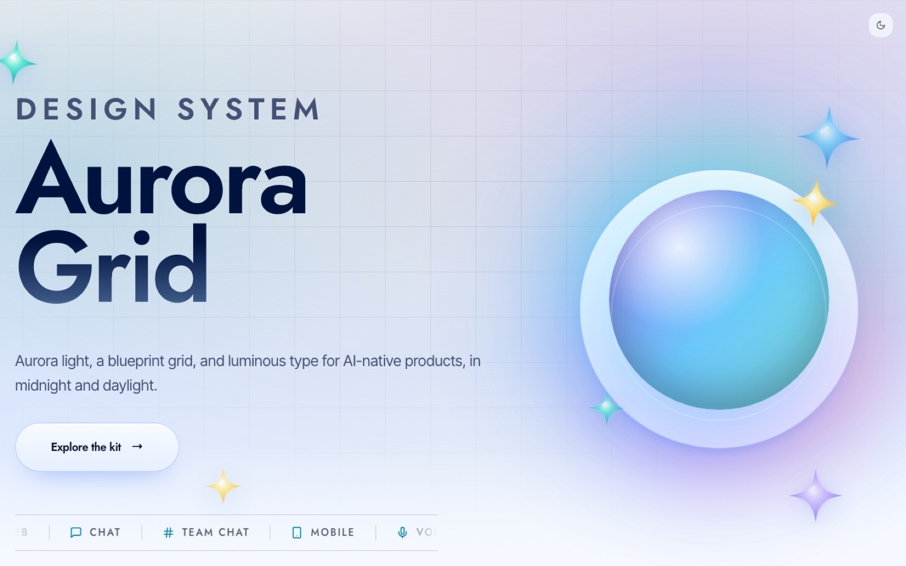
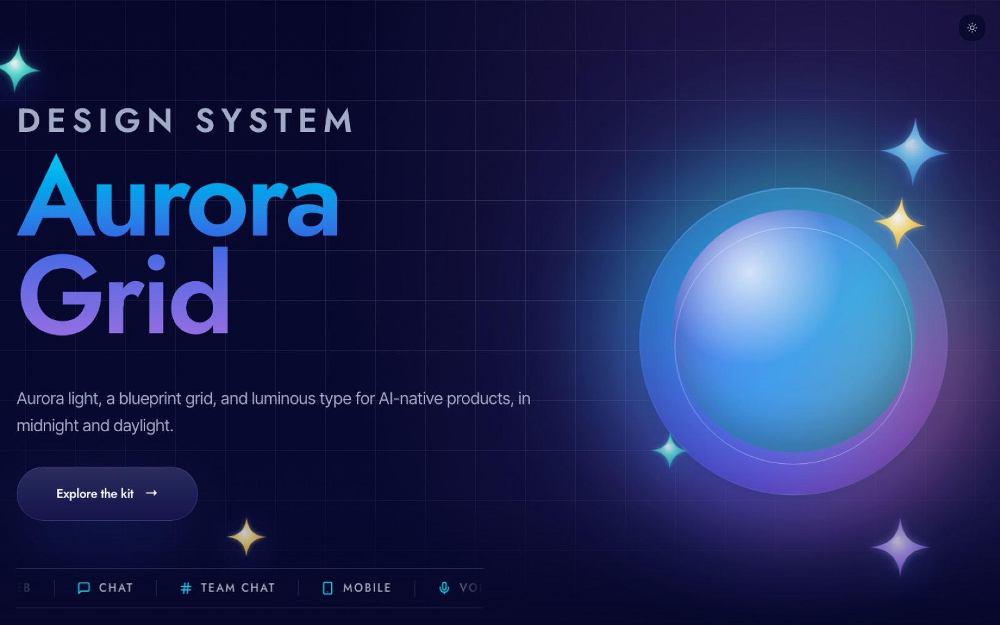
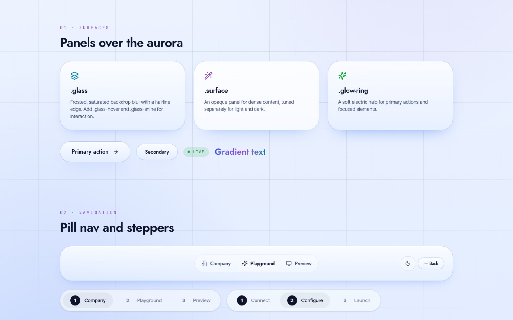
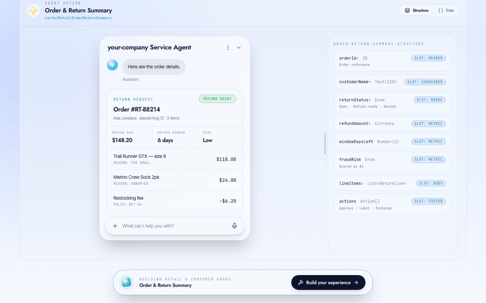
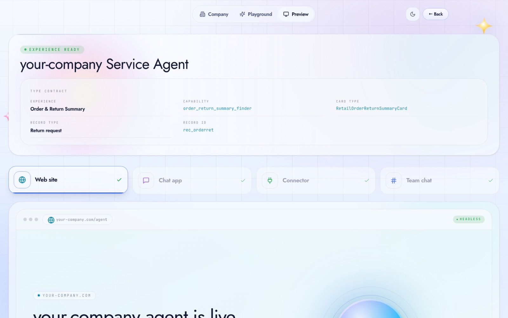

# Aurora Grid

**A design system and React component kit for Tailwind CSS v4, built around light in the dark.** It has a midnight-indigo base, aurora washes of electric blue, violet, and cyan, a blueprint grid that fades out from the centre, and luminous gradient headlines with tracked mono labels. A matching daylight theme keeps the same character. It's built for AI-native product UIs: assistants, builders, and multi-channel previews.



| Dark theme | Component gallery |
|---|---|
|  |  |

---

## What's inside

**Design system** (`src/styles/aurora.css`)

The look comes from four layers:

| Layer | What it is | Utilities and tokens |
|---|---|---|
| **Midnight base** | Deep indigo (OKLCH hue 274) in dark mode, and pale lavender in daylight | `background`, `foreground`, `surface`, `primary`, `accent` |
| **Aurora light** | Radial washes of electric blue, violet, and cyan bleeding into the page, with soft halos and glows | `.page-gradient`, `.logo-halo`, `.glow-ring`, `--shadow-glow`; `electric`, `violet-glow`, `cyan-glow` |
| **Blueprint grid** | A 72px hairline grid masked into a soft ellipse | `.grid-lines` (also built into `.page-gradient`) |
| **Luminous type** | Cyan-to-violet gradient headlines, tracked uppercase eyebrows, and mono labels, with `signal` green for live states | `.headline-ghost`, `.text-gradient`, `font-display` / `font-mono` |

Panels sit on top as frosted `.glass` (with `.glass-hover` and the `.glass-shine` sweep) or as denser `.surface` cards.
- **Motion:** `animate-rise`, `animate-drift`, `animate-float-slow`, `animate-sparkle`, `animate-sweep`, `animate-pulse-dot`, `animate-marquee`
- **Theme variants:** `light:` and `dark:`, switched by a class on `<html>`

**Components** (`src/components`)

| Component | What it does |
|---|---|
| `Hero` | Full-viewport hero: eyebrow, one- or two-line headline, subtitle, glass CTA, a pluggable `visual` (defaults to an animated glass orb), and a marquee rail |
| `Marquee` | Seamless CSS marquee with pause-on-hover, edge fade, and reduced-motion support |
| `SurfaceMarquee` | A marquee of labelled pills, for example the channels a product ships to |
| `TopNav` | Sticky, centered pill navigation with a theme toggle and a back button |
| `StepNav` | Numbered stepper pills |
| `ThemeToggle` | Light/dark switch that remembers the choice |

**Art** (`src/art`): generated SVG with no binary assets and nothing to license.
- Glass sparkles in five colors, plus `sparkleUrl(core, edge)` to make your own
- An assistant avatar orb
- Aurora and ombre background plates
- `IndustryArt` glass tiles for 10 industries
- `GlassOrb`

**Example flow** (`src/flow`)

A complete five-screen builder flow, assembled from the kit: hero → intake form → playground (industry picker plus live card preview with structure and data views) → animated build sequence → multi-channel launch view (web, chat app, connector, team chat).

| Playground | Launch |
|---|---|
|  |  |

---

## Run the demo

```bash
npm install
npm run dev        # gallery at http://localhost:5173, the flow at /#flow-demo
npm run typecheck
npm run build      # static demo in dist/
```

## Use it in your app

1. Copy `src/` into your project (for example `src/aurora-grid/`), or install the repo as a dependency.

2. Install the peers and the open-source fonts:
   ```bash
   npm install lucide-react clsx tailwind-merge tw-animate-css
   npm install @fontsource-variable/jost @fontsource-variable/inter-tight @fontsource-variable/jetbrains-mono
   ```

3. Import the styles once. `aurora.css` already includes `@import "tailwindcss"`:
   ```css
   @import "@fontsource-variable/jost";
   @import "@fontsource-variable/inter-tight";
   @import "@fontsource-variable/jetbrains-mono";
   @import "./aurora-grid/styles/aurora.css";
   @source "./";   /* let Tailwind scan your own components too */
   ```

4. Compose:
   ```tsx
   import { Hero, TopNav, SurfaceMarquee, IndustryArt } from "./aurora-grid";

   export default function Page() {
     return (
       <main className="page-gradient min-h-screen">
         <Hero
           eyebrow="Introducing"
           title={["Your", "Product"]}
           subtitle="One line about what it does."
           ctaLabel="Try it"
           onStart={() => {}}
         />
         <div className="glass glass-hover rounded-[2rem] p-8">A frosted panel over the aurora</div>
       </main>
     );
   }
   ```

   Or drop in the whole example: `<BuilderFlow initialStep="hero" onBuildRequested={...} />`.

## Customizing

- **Colors:** edit the OKLCH variables in `:root` (dark) and `.light` in `aurora.css`. The aurora washes, glows, grid, and glass tints all derive from them.
- **Fonts:** change `--font-display`, `--font-sans`, and `--font-mono` in the `@theme` block.
- **Art:** replace anything in `src/art` with your own assets. Components take plain image URLs or React nodes.
- **Hero visual:** pass any node to `<Hero visual={...} />`, such as a WebGL scene, a product shot, or a Lottie animation.

## Notes

- Tailwind CSS v4 syntax (`@theme`, `@utility`, `@custom-variant`). For v3, move the variables into `:root` and convert the `@utility` blocks to `@layer components`.
- React 18 or 19.

## License

[MIT](LICENSE)
